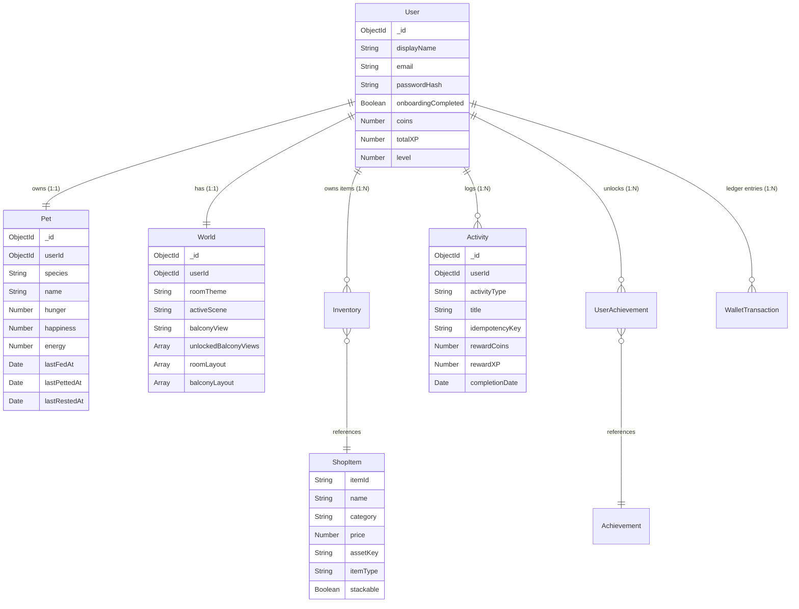

# 🗺️ TinyWorld — System Knowledge Graph & Architectural Blueprint

> **Purpose**: This knowledge graph documents the entire architecture, module dependencies, data flows, route security, and component hierarchy of the TinyWorld MERN application. 
> 
> **Maintenance Rule**: Whenever a file, route, model, context, or service is added or modified, update this graph so future modifications never require full-codebase re-indexing.

---

## 1. Visual System Architecture & Flow Graph

```mermaid
graph TD
    %% CLIENT LAYER
    subgraph Client ["Client (React 19 + Vite 8 + Tailwind CSS v4)"]
        UI_Entry["client/src/main.jsx<br/>(Bootstrap & Context Providers)"]
        App_Router["client/src/App.jsx<br/>(Router & Route Guards)"]
        
        subgraph Layouts ["Layout System"]
            PubLayout["layouts/PublicLayout.jsx<br/>(Public Header/Footer)"]
            AppLayout["layouts/AppLayout.jsx<br/>(Sidebar, Mobile Nav, User Badge)"]
        end

        subgraph Contexts ["State Management Contexts"]
            AuthCtx["context/AuthContext.jsx<br/>(User, Token, Login, Logout)"]
            GameCtx["context/GameContext.jsx<br/>(Pet stats, Inventory, Progress)"]
            RoomCtx["context/RoomContext.jsx<br/>(Layout coords, Edit mode, Debounced save)"]
        end

        subgraph Pages ["Pages & Views"]
            P_Landing["pages/LandingPage.jsx<br/>(Hero, Features, Room Preview)"]
            P_Login["pages/LoginPage.jsx<br/>(Sign in form)"]
            P_Register["pages/RegisterPage.jsx<br/>(Sign up form)"]
            P_Onboard["pages/OnboardingPage.jsx<br/>(Pet Adoption & Room Theme)"]
            P_Room["pages/GameRoomPage.jsx<br/>(Room Canvas, Pet Care, Controls)"]
            P_RoomScene["components/room/RoomScene.jsx<br/>(2D Engine, Drag & Drop, Depth)"]
            P_RoomIllustrations["components/room/RoomIllustrations.jsx<br/>(Cozy SVG Graphics)"]
            P_PetAvatar["components/room/PetAvatar.jsx<br/>(Animated Pets & Expressions)"]
            P_RoomInv["components/room/RoomInventoryDrawer.jsx<br/>(Category Tabs & Placement)"]
            P_Shop["pages/ShopPage.jsx<br/>(Catalog, Category tabs, Buy flow)"]
            P_Activities["pages/ActivitiesPage.jsx<br/>(Habit list, Custom modal, Daily stats)"]
            P_FocusTimer["components/activities/FocusTimer.jsx<br/>(Focus sprint timer, Circular SVG, Sound)"]
            P_Progress["pages/ProgressPage.jsx<br/>(Level XP bar, Achievements grid)"]
            P_Settings["pages/SettingsPage.jsx<br/>(Profile, Password, Audio toggles)"]
        end

        subgraph Services ["API Services Layer"]
            ApiClient["services/api.js<br/>(Axios Client, withCredentials, Interceptors)"]
            S_Auth["services/index.js -> authService"]
            S_Pet["services/index.js -> petService"]
            S_World["services/index.js -> worldService"]
            S_Shop["services/index.js -> shopService"]
            S_Act["services/index.js -> activityService"]
            S_Prog["services/index.js -> progressService"]
        end
    end

    %% SERVER LAYER
    subgraph Server ["Server (Express 4 + Node.js)"]
        S_Entry["server/src/server.js<br/>(Port 5000)"]
        S_App["server/src/app.js<br/>(Security, Cors, Middleware, Route Mounts)"]
        
        subgraph Middleware ["Middleware & Guards"]
            M_Auth["middleware/auth.js<br/>(JWT Cookie / Bearer verification)"]
            M_Rate["middleware/rateLimiter.js<br/>(Rate limits)"]
            M_Err["middleware/errorHandler.js<br/>(Centralized error formatter)"]
            M_Val["middleware/validate.js<br/>(express-validator)"]
        end

        subgraph Routes ["API Endpoints (/api/v1)"]
            R_Health["GET /api/health<br/>GET /api/v1/health (Public)"]
            R_Auth["/api/v1/auth<br/>(register, login, logout, me)"]
            R_Onboard["/api/v1/onboarding<br/>(setup - Protected)"]
            R_World["/api/v1/world<br/>(get, layout, theme - Protected)"]
            R_Pet["/api/v1/pet<br/>(get, feed, pet, rest - Protected)"]
            R_Shop["/api/v1/shop<br/>(catalog, buy, inventory - Protected)"]
            R_Act["/api/v1/activities<br/>(types, complete, summary - Protected)"]
            R_Prog["/api/v1/progress<br/>(stats, achievements - Protected)"]
            R_Users["/api/v1/users<br/>(profile, password - Protected)"]
        end

        subgraph Controllers ["Controllers (Business Logic)"]
            C_Auth["controllers/authController.js"]
            C_Onboard["controllers/onboardingController.js"]
            C_World["controllers/worldController.js"]
            C_Pet["controllers/petController.js"]
            C_Shop["controllers/shopController.js"]
            C_Act["controllers/activityController.js"]
            C_Prog["controllers/progressController.js"]
            C_Users["controllers/userController.js"]
        end

        subgraph Utilities ["Core Game Utilities"]
            U_AchCheck["utils/achievementChecker.js<br/>(Server-authoritative badge unlocks, bonuses, wallet ledger)"]
        end

        subgraph Models ["Mongoose Models"]
            MDL_User["models/User.js<br/>(Bcrypt hash, level, XP, coins)"]
            MDL_Pet["models/Pet.js<br/>(Hunger, Happiness, Energy, Decay)"]
            MDL_World["models/World.js<br/>(RoomTheme, PlacedItems coordinates)"]
            MDL_Shop["models/ShopItem.js<br/>(Price, category, assetKey, rarity)"]
            MDL_Inv["models/Inventory.js<br/>(User items, quantities)"]
            MDL_Act["models/Activity.js<br/>(IdempotencyKey, rewards, history)"]
            MDL_Ach["models/Achievement.js<br/>(Badges, requirements, coins)"]
            MDL_UAch["models/UserAchievement.js<br/>(Unlocked badges)"]
            MDL_Tx["models/WalletTransaction.js<br/>(Coin ledger)"]
        end
    end

    %% DATABASE LAYER
    subgraph Database ["MongoDB Atlas Cluster0"]
        DB_Users[("users")]
        DB_Pets[("pets")]
        DB_Worlds[("worlds")]
        DB_ShopItems[("shopitems")]
        DB_Inventory[("inventories")]
        DB_Activities[("activities")]
        DB_Achievements[("achievements")]
        DB_UserAch[("userachievements")]
        DB_Transactions[("wallettransactions")]
    end

    %% CONNECTIONS
    UI_Entry --> App_Router
    App_Router --> PubLayout
    App_Router --> AppLayout
    PubLayout --> P_Landing
    PubLayout --> P_Login
    PubLayout --> P_Register
    AppLayout --> P_Room
    AppLayout --> P_Shop
    AppLayout --> P_Activities
    AppLayout --> P_Progress
    AppLayout --> P_Settings
    App_Router --> P_Onboard

    Pages --> Contexts
    Contexts --> Services
    Services --> ApiClient
    ApiClient -->|HTTP JSON + Cookie| S_App

    S_Entry --> S_App
    S_App --> R_Health
    S_App --> R_Auth
    S_App --> R_Onboard
    S_App --> R_World
    S_App --> R_Pet
    S_App --> R_Shop
    S_App --> R_Act
    S_App --> R_Prog
    S_App --> R_Users

    R_Auth --> C_Auth
    R_Onboard --> M_Auth --> C_Onboard
    R_World --> M_Auth --> C_World
    R_Pet --> M_Auth --> C_Pet
    R_Shop --> M_Auth --> C_Shop
    R_Act --> M_Auth --> C_Act
    R_Prog --> M_Auth --> C_Prog
    R_Users --> M_Auth --> C_Users

    C_Auth --> MDL_User
    C_Onboard --> MDL_User & MDL_Pet & MDL_World & MDL_Inv
    C_World --> MDL_World
    C_Pet --> MDL_Pet
    C_Shop --> MDL_Shop & MDL_Inv & MDL_User & MDL_Tx
    C_Act --> MDL_Act & MDL_User & MDL_Pet & MDL_Tx
    C_Prog --> MDL_User & MDL_Ach & MDL_UAch
    C_Users --> MDL_User

    MDL_User --> DB_Users
    MDL_Pet --> DB_Pets
    MDL_World --> DB_Worlds
    MDL_Shop --> DB_ShopItems
    MDL_Inv --> DB_Inventory
    MDL_Act --> DB_Activities
    MDL_Ach --> DB_Achievements
    MDL_UAch --> DB_UserAch
    MDL_Tx --> DB_Transactions
```

---

## 2. Component & Context Dependency Matrix

| Frontend Module | Relies On Contexts | Relies On Services | Key State & Responsibilities |
| :--- | :--- | :--- | :--- |
| **`App.jsx`** | `AuthContext` | None | Defines routes, applies `ProtectedRoute` / `GuestRoute`, redirects to onboarding if `!user.onboardingCompleted`. |
| **`AppLayout.jsx`** | `AuthContext`, `GameContext` | None | Desktop sticky sidebar (user avatar, coin count, level) + mobile bottom tab bar; triggers `refreshGameData()` on mount. |
| **`AuthContext.jsx`** | None | `authService` | Holds `user`, `loading`, provides `login()`, `register()`, `logout()`, `updateUser()`. Auto-checks `/auth/me` on initial boot. |
| **`GameContext.jsx`** | `AuthContext` | `petService`, `shopService`, `progressService` | Holds `pet`, `inventory`, `progress`; provides refetch functions for all game state across pages. |
| **`RoomContext.jsx`** | None | `worldService` | Holds `world`, `editMode`, `selectedItem`, `undo()`, `cancelEdit()`, `saveAndExit()`, `rotateItem()`, `changeLayer()`, `removeItem()`. Debounces layout saves to backend. |
| **`GameRoomPage.jsx`** | `AuthContext`, `GameContext`, `RoomContext` | `petService` | Coordinates HUD, 2D RoomScene, RoomInventoryDrawer, Edit mode toolbar (Undo, Save, Cancel), and pet care vitals. |
| **`RoomScene.jsx`** | None | None | 2D game canvas with themed wallpaper, baseboard, animated scenic window, perspective floor planks, pointer-based drag & drop, bounds clamping, 45° rotation, dynamic Y/layer depth sorting, and floating action pill. |
| **`RoomIllustrations.jsx`** | None | None | Scalable cozy SVG illustrations for all furniture, plants, rugs, lamps, bookshelves, desks, and wall decor. |
| **`PetAvatar.jsx`** | None | None | Animated SVG companions (Mochi the Cat, Pebble the Bunny, Sprout) with idle breathing, happy hearts, eating, and sleepy Zzz expressions with overhead speech bubbles. |
| **`RoomInventoryDrawer.jsx`** | None | None | Slide-out drawer with category tabs (All, Furniture, Plants, Decor), illustration previews, placed vs owned counts, and 1-click placement. |
| **`ActivitiesPage.jsx`**| `AuthContext`, `GameContext` | `activityService` | Displays daily progress meter, habit cards (Done buttons), focus sprint timer integration, activity history, and **Custom Activity Modal** with categories. |
| **`FocusTimer.jsx`** | None | None | Pomodoro & focus sprint countdown timer with 15/25/45m presets, circular SVG progress ring, pause/resume/reset, audio chimes, and automatic activity reward logging on completion. |
| **`ShopPage.jsx`** | `AuthContext`, `GameContext` | `shopService` | Category filter tabs, item cards with vector SVG illustrations, rarity tags, level locks, coin balance, and purchase confirmation with duplicate prevention. |
| **`ProgressPage.jsx`** | `AuthContext`, `GameContext` | `progressService` | Shows Level XP progress bar, player level stats, unlocked achievement badges showcase, and real-time wallet transaction ledger. |
| **`SettingsPage.jsx`** | `AuthContext` | `userService` | Change display name, update password with current password verification, and audio/notification preferences. |

---

## 3. Server Endpoints & Route Security Matrix

| Method | Endpoint | Protection | Middleware | Controller Handler | Purpose |
| :--- | :--- | :--- | :--- | :--- | :--- |
| `GET` | `/api/health` | Public | None | Inline | Reports API status, uptime, and MongoDB connectivity (`connected`). |
| `GET` | `/api/v1/health` | Public | None | Inline | Alias for `/api/health`. |
| `POST` | `/api/v1/auth/register` | Public | `validateRegister` | `authController.register` | Validates input, hashes password (bcrypt 12 rounds), issues HTTP-only JWT cookie. |
| `POST` | `/api/v1/auth/login` | Public | `validateLogin` | `authController.login` | Compares bcrypt hash, sets HTTP-only cookie, returns safe user object. |
| `POST` | `/api/v1/auth/logout` | Public | None | `authController.logout` | Clears `token` cookie. |
| `GET` | `/api/v1/auth/me` | Protected | `auth` | `authController.getMe` | Returns authenticated user session data without password hash. |
| `POST` | `/api/v1/onboarding/setup`| Protected | `auth` | `onboardingController.setup`| Adopts chosen pet, initializes room theme, creates default starter items. |
| `GET` | `/api/v1/pet` | Protected | `auth` | `petController.getPet` | Calculates decayed hunger/happiness/energy based on elapsed time and returns pet. |
| `POST` | `/api/v1/pet/feed` | Protected | `auth` | `petController.feed` | Restores hunger (+25) & happiness (+10). |
| `POST` | `/api/v1/pet/pet` | Protected | `auth` | `petController.petPet` | Increases happiness (+20) & energy (+5). |
| `POST` | `/api/v1/pet/rest` | Protected | `auth` | `petController.rest` | Restores energy (+30). |
| `GET` | `/api/v1/world` | Protected | `auth` | `worldController.getWorld` | Returns room theme, wall style, floor style, and array of placed items. |
| `PUT` | `/api/v1/world/layout` | Protected | `auth` | `worldController.updateLayout` | Validates normalized coords (`0 <= x,y <= 1`, max 30 items) and persists. |
| `PUT` | `/api/v1/world/theme` | Protected | `auth` | `worldController.updateTheme` | Updates room color scheme (`cozy`, `forest`, `cloud`, `ocean`). |
| `GET` | `/api/v1/activities` | Protected | `auth` | `activityController.getActivityTypes`| Returns available activities with coin & XP reward definitions. |
| `POST` | `/api/v1/activities/complete`| Protected | `auth` | `activityController.complete` | Idempotent completion: checks duplicate key, applies daily limit, increments user XP/coins. |
| `GET` | `/api/v1/activities/summary` | Protected | `auth` | `activityController.getSummary` | Returns today's completed count, earned coins, and earned XP. |
| `GET` | `/api/v1/shop/items` | Protected | `auth` | `shopController.getItems` | Returns active shop catalog filtered by category or user level. |
| `POST` | `/api/v1/shop/buy` | Protected | `auth` | `shopController.buyItem` | Checks balance, deducts coins, adds to user inventory, checks achievement. |
| `GET` | `/api/v1/progress` | Protected | `auth` | `progressController.getProgress` | Returns user level, total XP, stats, and all achievements with unlocked status. |

---

## 4. Environment Variables Specification

### Server (`server/.env`)
| Variable | Value / Format | Purpose | Consumed By |
| :--- | :--- | :--- | :--- |
| `MONGODB_URI` | `mongodb+srv://...` | MongoDB Atlas database connection string | `server/src/config/db.js` |
| `JWT_SECRET` | Secret string | Key used to sign and verify JSON Web Tokens | `server/src/controllers/authController.js`, `server/src/middleware/auth.js` |
| `JWT_EXPIRES_IN`| `7d` | Expiration lifetime for tokens | `server/src/controllers/authController.js` |
| `PORT` | `5000` | HTTP port for the Express application | `server/src/server.js` |
| `NODE_ENV` | `development` / `production` | Environment switch (disables dev logs in prod) | `server/src/config/env.js`, `server/src/app.js` |
| `CLIENT_URL` | `http://localhost:5173` | Allowed CORS origin for Vite dev server | `server/src/config/cors.js` |
| `COOKIE_SECURE` | `false` (dev) / `true` (prod) | Whether cookie requires HTTPS | `server/src/controllers/authController.js` |
| `COOKIE_SAME_SITE`| `lax` | Cross-site cookie attribute | `server/src/controllers/authController.js` |

### Client (`client/.env`)
| Variable | Value | Purpose | Consumed By |
| :--- | :--- | :--- | :--- |
| `VITE_API_URL` | `http://localhost:5000/api/v1` | Base URL for the Axios API client | `client/src/services/api.js` |

---

## 5. Database Schema & Relationships

---

## 6. How to Update This Graph

When modifying the project:
1. **Adding an API route**:
   - Add the route to Section 3 (Route Security Matrix).
   - Update the Server subgraph in the Mermaid diagram.
2. **Adding a React Component or Page**:
   - Add the file to Section 2 (Component Matrix) with its contexts and services.
   - Update the Client subgraph in the Mermaid diagram.
3. **Modifying a Mongoose Model**:
   - Update the schema field in Section 5 (ER Diagram).
4. **Changing Environment Keys**:
   - Update Section 4 (Environment Variables Specification).

---

## 7. Automated Test Suites & Verification Coverage

| Test Suite Script | Tests / Assertions | Scope & Invariants Verified |
| :--- | :--- | :--- |
| **`server/scripts/test-auth-onboarding.js`** | **40 / 40 PASS** | Registration validation, bcrypt 12-round hashing, HTTP-only JWT cookies, protected route 401s, onboarding pet creation, room initialization, starter inventory, duplicate onboarding guard, user data isolation, logout session termination, and password change flow verification. |
| **`server/scripts/test-room-scene.js`** | **31 / 31 PASS** | Room access authentication, starter room verification, normalized coordinate clamping (`0 <= x,y <= 1`), rotation angle persistence, inventory ownership checks (403 for unowned items), max 30-item capacity limit, and room theme customization. |
| **`server/scripts/test-activity-progression.js`**| **44 / 44 PASS** | Server-authoritative rewards (`ACTIVITY_REWARDS`), idempotency duplicate completion prevention (`idempotencyKey`), daily goal meter and 10/day limits, pet XP/level/happiness boosts, level progression formula, shop catalog level locks (403), insufficient coin checks (400), duplicate item prevention (409), wallet transaction ledger (`earn` & `spend`), automatic achievement unlocks with coin bonuses, and multi-user data isolation. |
| **Total Automated Coverage** | **115 / 115 PASS** | Complete end-to-end API and business logic coverage (`npm test`). |
